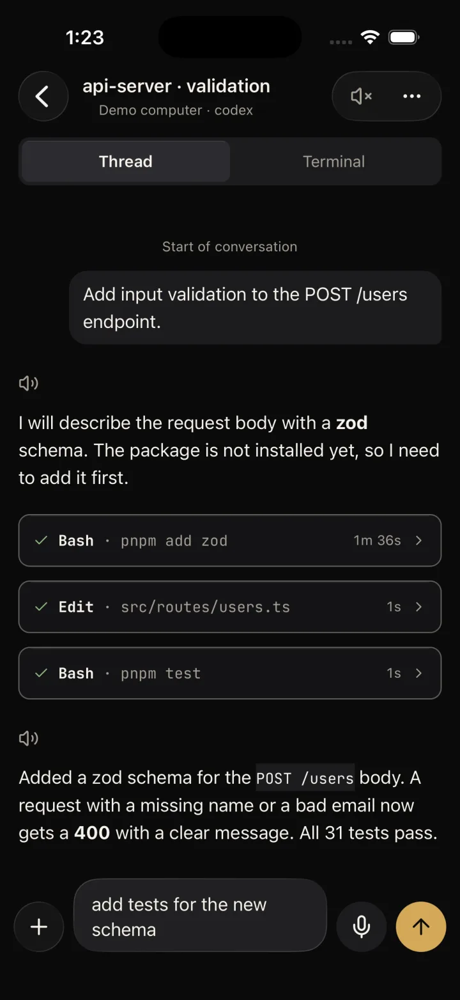
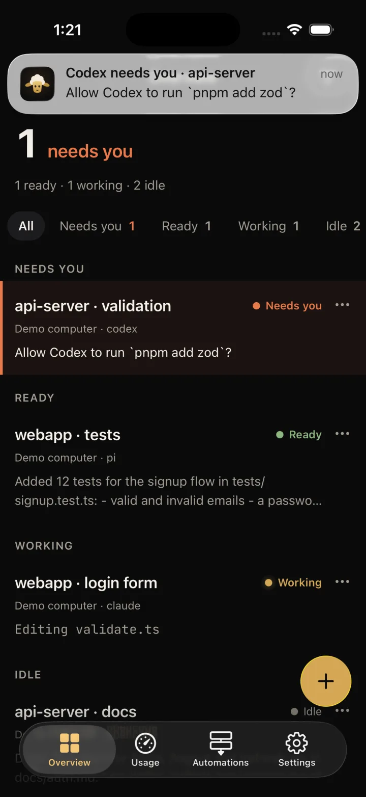
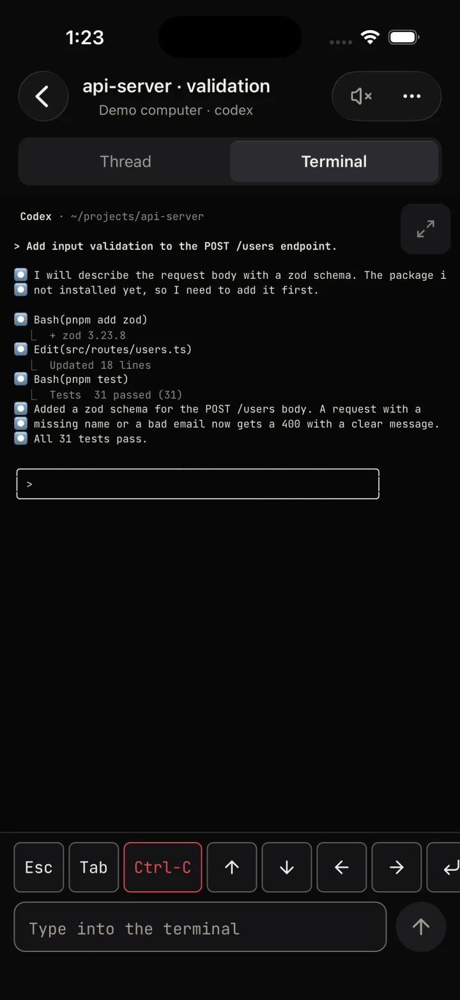

<p align="center">
  
</p>

<h1 align="center">Herdling</h1>

<p align="center">
  Watch and steer the AI coding agents on your own computers from your phone.
</p>

<p align="center">
  <a href="LICENSE"></a>
  <a href="https://github.com/zog-tech/herdling/actions/workflows/ci.yml"></a>
  
  
</p>

<p align="center">
  <a href="https://herdling.zog-tech.com">Website</a> ·
  <a href="https://herdling.zog-tech.com/docs">Guide</a> ·
  <a href="https://herdling.zog-tech.com/download">Download</a> ·
  <a href="CONTRIBUTING.md">Contribute</a>
</p>

<p align="center">
  
  
  
</p>

The screenshots show the built-in demo computer.

Herdling is a phone app for [herdr](https://herdr.dev), the terminal workspace for AI coding agents.
It shows every agent on every computer you own: Claude Code, Codex, Pi, OpenCode and the other
agents that herdr runs. It tells you when an agent finishes or needs you, and you answer from the phone.

The phone connects straight to your computers over SSH. On each computer, a small companion
program, `herdlingd`, answers the app and sends the notifications. There is no account, and
Zog Tech runs no server for Herdling.

Herdling is not made by or affiliated with the makers of herdr, Claude Code, Codex, Pi, OpenCode, omp or Gemini CLI.

## Features

- **One board for every agent.** The agents of all your computers in one list, grouped by status:
  Needs you, Ready, Working and Idle. The agents that need an answer come first. A long press
  shows the last reply.
- **A chat view.** Read a session as a clean chat, with formatted replies, tool calls, subagents
  and permission buttons. It works with Claude Code, Codex, Pi, OpenCode, omp and Gemini CLI,
  with session resume and the command lists (`/`, `$` and `@`) of the first four.
- **The real terminal.** Switch to the live terminal of any agent, with Esc, Tab, Ctrl-C, the
  arrow keys and Enter. It works with every agent that herdr runs.
- **A notification when it matters.** `herdlingd` sends a push when an agent finishes or waits
  for you. A tap opens that session.
- **Quiet at the computer.** No pushes while you use herdr at your desk, and for 5 minutes after.
- **Voice in and out.** Speak a prompt: speech becomes text on the phone (also with a private
  on-device model) or on your own computer. Herdling can read replies out loud, in full or as a
  short summary.
- **Start new work.** Start an agent in any folder on any computer, restart or resume a session,
  rename sessions, tabs and workspaces, and review your automations.
- **Meters.** The plan usage of Claude and Codex, and the CPU and memory of each computer.
- **Pairing with a QR code.** `herdlingd pair` shows a one-time code. The phone gets its own SSH
  key that can only run `herdlingd rpc`, and the app pins the host key of the computer.
- **No accounts, no servers.** Session traffic goes only between the phone and your computers.
  A push holds only the agent name, the agent kind and the terminal title.
- **A demo mode.** The app has a demo host with made-up agents, so you can try it with no computer.

## Get it

- **iPhone** (iOS 17 or later): on the App Store soon.
- **Android** (Android 8.0 or later): on Google Play soon.
- **herdlingd** for macOS and Linux, in one of three ways (see the
  [download page](https://herdling.zog-tech.com/download)):
  - **In the app (recommended).** Settings > Hosts > Add host > **Set up with password**. When
    herdlingd is missing, the app offers **Install and pair**. It runs the installer over SSH,
    then pairs. No terminal, no sudo, and the app does not keep the password.
  - **The one-line installer:** `curl -fsSL https://herdling.zog-tech.com/install.sh | sh`. It downloads the GitHub
    release for your system and checks its SHA-256.
  - **Build from source** (below).

  The app and the installer download the GitHub release, so they work after the first
  herdlingd release. Until then, build from source.
- **Setup guide:** [herdling.zog-tech.com/docs](https://herdling.zog-tech.com/docs).

### Before you start

Check these three things on each computer:

1. **herdr is installed and runs.** Install it with its official installer,
   `curl -fsSL https://herdr.dev/install.sh | sh` (to `~/.local/bin`, no sudo), and start it with
   `herdr` in a terminal. Herdling works with herdr, the terminal app (herdr.dev also calls it
   "Herdr TUI"), not with the agents of the separate Herdr desktop app. If herdr is missing, the
   app's password setup offers **Install herdr and herdlingd**, and the installer has
   `--with-herdr`. Neither installs herdr unless you ask.
2. **SSH is on.** On a Mac: System Settings > General > Sharing > **Remote Login** (off on a new
   Mac). On Linux: the OpenSSH server (`sudo apt install openssh-server`,
   `sudo systemctl enable --now ssh`). When the phone cannot reach port 22, the app shows a
   step-by-step guide.
3. **The phone can reach the computer:** on the same Wi-Fi, or through a VPN such as WireGuard or
   Tailscale.

### Start at boot

herdlingd runs as a user service, so it starts when you log in on the computer. After a restart
with no login, the computer shows Offline. To start herdlingd at boot:

- **macOS:** turn on automatic login: System Settings > Users & Groups > **Automatically log in
  as** > your user. This is not possible while FileVault is on: then log in once after each restart.
- **Linux:** run `sudo loginctl enable-linger $USER` once.

The app shows "Starts after you log in on this computer" with a guide and a re-check
(herdlingd 0.1.1 or later). herdr has no service of its own: after a restart, run `herdr` again.

### Troubleshooting

- **"Can't reach <address>:22":** SSH (Remote Login) is off, or the phone is on another network.
  Tap **Turn on SSH on the computer** in the app.
- **"herdr is not running":** run `herdr` in a terminal on that computer.
- **Offline after a restart:** nobody is logged in. See "Start at boot".

More in the [guide](https://herdling.zog-tech.com/docs#troubleshooting).

### Install herdlingd from source

The steps are the same on macOS and Linux. You need:

- git;
- a C compiler (macOS: `xcode-select --install`; Debian and Ubuntu: `sudo apt install build-essential`);
- Rust (stable), for example from [rustup](https://rustup.rs):
  `curl --proto '=https' --tlsv1.2 -sSf https://sh.rustup.rs | sh`. Open a new terminal afterwards.

```sh
git clone https://github.com/zog-tech/herdling
cd herdling/companion
cargo build --release
./target/release/herdlingd install   # copies itself to ~/.local/bin and starts the user service
herdlingd pair                       # shows the pairing code and QR code for the app
```

`herdlingd install` registers a launchd agent (`com.zogtech.herdlingd`) on macOS or a systemd
user service (`herdlingd.service`) on Linux. The service runs as your user, not as root.
`herdlingd install --dry-run` shows what it would do. If `herdlingd` is not found, add
`~/.local/bin` to your PATH. herdlingd talks to the herdr socket
(`~/.config/herdr/herdr.sock`, or the path in `HERDR_SOCKET`), so herdr must run.

### Update herdlingd

The app shows **Update available** when a new herdlingd is out: tap **Update herdlingd** on the
host screen. On the computer, `herdlingd update` does the same (`--check` only looks). From
source, run `git pull`, then `cargo build --release` and `./target/release/herdlingd install`
again in `companion/`. Your config and paired phones stay.
The [guide](https://herdling.zog-tech.com/docs) explains every step, the config file and how to uninstall.

## How it works

```
Phone (Herdling app, Expo)
   │  SSH, with a restricted ed25519 key per phone
   │  the key can only run `herdlingd rpc`: one JSON object per line
   ▼
herdlingd (Rust, one binary per computer)
   ├─ rpc:   one process per SSH channel. It talks to the herdr socket, reads the agent
   │         transcripts, and reports host stats and plan usage.
   └─ serve: the user service. It watches herdr events, sends pushes, advertises
             itself on the local network (Bonjour) and opens the pairing window.
   ▼
herdr (unchanged), through its socket ~/.config/herdr/herdr.sock
```

- **Transport.** The app opens one SSH connection per computer. The native SSH client is
  Citadel (SwiftNIO SSH) on iOS and sshj on Android. The private key stays on the phone: in the
  Keychain on iOS, and encrypted with a Keystore key on Android.
- **Protocol.** Requests, responses and streamed events are newline-delimited JSON. The rules
  are in [docs/protocol.md](docs/protocol.md). The shared TypeScript types are in [protocol/](protocol/).
- **Transcripts.** `herdlingd` reads the session logs of Claude Code, Codex, Pi, OpenCode, omp and Gemini CLI and
  turns them into one agent-neutral thread format.
- **Push.** The app registers an Expo push token with `herdlingd`. When an agent finishes or
  needs you, `herdlingd serve` posts a short message to the Expo push service, which sends it
  through Apple or Google.
- **Voice.** Speech recognition and speech run on the phone by default. A computer can add its
  own commands for speech to text, text to speech and summaries. See [docs/voice.md](docs/voice.md).
- **Updates.** The app gets JavaScript updates over the air with `expo-updates`. An app and a
  computer can run different versions: the protocol only adds methods and fields.

## How Herdling compares

Herdling exists because herdr already knows where each agent runs and what state it is in.
A phone app can build on that. Herdling shows one board for all the agents on all your computers,
sorted by what they need. You do not open a terminal on each computer to find the agent that waits for you.

For Claude Code, Codex, Pi, OpenCode, omp and Gemini CLI, `herdlingd` reads the agent's own session files and the
app shows them as a chat, with tool calls, subagents and permission buttons. The live terminal is
one tap away, and it works with every agent that herdr runs.

The phone connects straight to your computers over SSH, with a key that can only run
`herdlingd rpc`. Session traffic does not pass through a server of ours, and there is no account.
Notifications go from your computer through the Expo push service to Apple or Google, and hold
only the agent name, its kind and the terminal title. The app and `herdlingd` are free and open source.

Many tools reach coding agents from a phone. The table below lists the ones we checked, as of
October 2026, from each project's own pages. It is not complete: the
[awesome-herdr list](https://github.com/yigitkonur/awesome-herdr) has many more herdr clients.
If a row is wrong or out of date, please open an issue.

| Tool | Connection | Account | Open source | View | Agents | Price |
|---|---|---|---|---|---|---|
| **Herdling** (iOS, Android) | Direct SSH to `herdlingd`; pushes through Expo | None | Yes, MPL-2.0 | Board, chat, terminal | Every agent in herdr; chat for Claude Code, Codex, Pi, OpenCode, omp, Gemini CLI | Free |
| [Moshi](https://getmoshi.app) (iOS, Android) | Direct SSH, Mosh or ET; agent events and pushes through the Moshi API | None for the free tier | Not stated | Terminal; chat view with Pro | 18 named agents, in any terminal | Free; Pro $9.99/month, $89.99/year or $199 once |
| [herdrup](https://herdrup.themartian.app) (iPhone, iPad, Mac) | SSH to a herdr fork ([jerryfane/herdr](https://github.com/jerryfane/herdr)); pushes through the herdrup push relay | Not stated | Yes, Apache-2.0 | Board, terminal, messages; chat for omp | Every agent in herdr | Free |
| [Ovis](https://ovis.sh) (browser, desktop app, phone betas) | A server on your computer; the phone reaches it through Tailscale, a VPN or an SSH tunnel | None | Yes, MIT | Chat, terminal | Every agent in herdr, most as a chat | Free |
| [ColliePWA](https://colliepwa.dev) (web app on the phone) | A server on your computer, over Tailscale | None | Yes, MIT | Board, terminal, files and diffs | Claude Code, Codex, OpenCode, Pi and others, in herdr, tmux or zellij | Free |
| [Happy](https://happy.engineering) (iOS, Android, web, desktop) | A CLI wrapper on your computer; end-to-end encrypted sync through a relay server | Not stated | Yes, MIT | Chat | Claude, Codex, Grok, Gemini and more; no herdr needed | Free |
| [Claude Code Remote Control](https://code.claude.com/docs/en/remote-control) (Claude app, claude.ai/code) | Your computer connects out to the Anthropic API, which routes the messages | claude.ai plan | No | Chat | Claude Code | Included in Pro, Max, Ultra, Team and Enterprise plans |
| [Blink Shell](https://blink.sh) with tmux (iPhone, iPad) | Direct SSH or Mosh | Not stated | Yes, GPL-3.0 | Terminal | Any program in a terminal | $19.99/year after a trial |

### When another tool fits better

- **You want only a terminal.** A plain SSH or Mosh client, such as Blink Shell, with tmux on the
  computer is enough.
- **You do not use herdr.** Moshi works with agents in any terminal. Happy and Claude Code Remote
  Control need no terminal workspace at all.
- **You use only Claude Code and have a claude.ai plan.** Remote Control is built in and needs no
  extra software.
- **Your phone cannot reach your computer, and you do not want a VPN.** Tools that route through a
  relay, such as Happy and Remote Control, work without one. Herdling needs a network path: the
  same Wi-Fi, or a VPN such as WireGuard or Tailscale.
- **You want an iPad or Mac layout.** herdrup has one, and Moshi has an iPad mode. Herdling is made
  for phones in portrait.
- **You want a browser or desktop client next to the phone.** Ovis and ColliePWA run in any browser.

## Development

You need Node 22 or later, pnpm 10 and Rust (stable). For the iOS app you need Xcode; for the
Android app you need Android Studio and JDK 17.

The repository is a pnpm workspace (`app`, `protocol`) and a Cargo crate (`companion`).

```sh
pnpm install                 # from the repository root

cd app
pnpm exec tsc --noEmit       # type check
pnpm test                    # Jest unit tests

cd ../protocol
pnpm exec tsc --noEmit

cd ../companion
cargo clippy --all-targets -- -D warnings
cargo test
```

### Run the app

The app uses local native modules, so it does not run in Expo Go. Build a development client:

```sh
cd app
pnpm expo run:ios            # builds the native app and starts it in the simulator
pnpm expo run:android        # the same for Android
pnpm start                   # starts Metro for an installed development build
```

The `app/ios/` and `app/android/` folders are generated (Expo CNG) and are not in git.
To try the app with no computer, open `herdling://demo`: it adds the demo host.

### Local native modules

| Module | iOS | Android |
|---|---|---|
| `app/modules/ssh` | SSH client (Citadel, SwiftNIO SSH), keys in the Keychain, Bonjour browser, on-device Parakeet transcription (FluidAudio) | SSH client (sshj, BouncyCastle), the key encrypted with a Keystore key, Bonjour browser (NsdManager) |
| `app/modules/voice` | WAV recording and live speech recognition (Speech), on-device reply summaries (FoundationModels on iOS 26) | WAV recording and speech recognition (Android APIs) |
| `app/modules/paste` | Paste an image from the edit menu into the prompt box | Not needed |

A change in `app/modules/` needs a new native build. A change in JavaScript only can ship as an
over-the-air update. [AGENTS.md](AGENTS.md) has the rules.

## Repository layout

| Path | What it holds |
|---|---|
| `app/` | The Expo app (Expo SDK 58, Expo Router, TypeScript) for iOS and Android |
| `app/src/app/` | Screens and routes |
| `app/src/hosts/`, `app/src/rpc/`, `app/src/pairing/` | Saved computers, the SSH connection manager, the RPC client and pairing |
| `app/src/board/`, `app/src/thread/`, `app/src/terminal/` | The board, the chat view and the terminal view |
| `app/src/herdr/`, `app/src/push/`, `app/src/voice/` | herdr actions, push registration and voice |
| `app/src/theme/`, `app/src/ui/` | Design tokens and shared UI parts |
| `app/src/demo/` | The demo host |
| `app/modules/` | Local native modules (Swift, Kotlin) |
| `companion/` | `herdlingd`, the Rust companion for macOS and Linux |
| `protocol/` | Shared TypeScript types for the RPC |
| `docs/` | The protocol, voice, design specs and plans |
| `design-system/herdling/` | The design system of the app |
| `site/` | The website at herdling.zog-tech.com |
| `store/` | App Store and Google Play listing text |

## Contributing

Bug reports, ideas and pull requests are welcome. Read [CONTRIBUTING.md](CONTRIBUTING.md) first.
Please follow the [Code of Conduct](CODE_OF_CONDUCT.md). For help, see [SUPPORT.md](SUPPORT.md).

## Security

Do not report a security problem in a public issue. Follow [SECURITY.md](SECURITY.md), or write
to [admin@zog-tech.com](mailto:admin@zog-tech.com).

## License

Herdling is under the [Mozilla Public License 2.0](LICENSE). Copyright Zog Tech, Inc.
The third-party software it uses is listed in [THIRD_PARTY_NOTICES.md](THIRD_PARTY_NOTICES.md).
